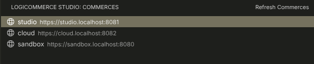
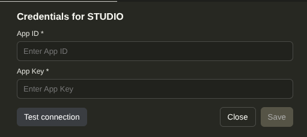

# LogiCommerce frontoffice-dev

This repository contains the base Dev Container template for building and testing LogiCommerce headless front-office projects. It provides a pre-configured PHP + Apache + Redis environment that runs locally and connects to the LogiCommerce APIs.

The default configuration reflects how agencies typically work today. You can use it as-is, extend the image, or override settings at the commerce level to fit your specific workflow.

Multiple environments can be configured simultaneously to work as independent sandboxes, useful for testing the same code against different commerce configurations. By convention, only the environment named `cloud` connects to the production API; all other environments connect to the Studio API.

The recommended way to work with this template is through the **LogiCommerce Studio** VS Code extension, which automates the full setup and daily workflow. If you prefer to set things up manually or want a deeper understanding of how the container works, refer to [FRONTDEV.md](FRONTDEV.md).

---

## Recommended: Use Logicommerce Studio extension



> [!NOTE]
> On **Windows**, use the extension from a **WSL (Remote-WSL)** session with the project stored in the WSL filesystem - it does not work on native Windows. See [WINDOWS-WSL.md](WINDOWS-WSL.md) for the one-time setup.

### How to use it

1. Install the **Logicommerce Studio** extension from the VS Code Marketplace.  
2. Open a folder you want to use as your LogiCommerce workspace.  
3. Run the Logicommerce Studio commands from the Command Palette:
   - Initialize the workspace and Dev Container.
   - Add or select a commerce.
   - Open the Dev Container and start working on the front-office.

The extension will create and manage the necessary structure and configuration files for you, including the Dev Container definition.

---

#### Compatibility with `frontoffice-dev`

This extension is fully compatible with the public `frontoffice-dev` model if you follow it. If your project has been created following the `frontoffice-dev` structure, Logicommerce Studio will detect and reuse it, keeping the `www` symlink and core assets pointing to the correct locations.

If you want to reuse the workspace, follow these tips:

##### On Host

- If you manage the lc folder manually, clone the latest versions of the SDK, framework, and PHP plugin from GitHub to keep it up to date.
- Add the extension to your `devcontainer.json`.

```jsonc
"customizations": {
  "vscode": {
    "extensions": [
      ...
      "logicommerce.logicommerce-studio-extension"
    ]
  }
}
```

##### Inside Dev Container

- If you want to use the panel to configure connections, delete your local `config.php` file and reconfigure it.  
  You only need the credentials to access your commerce.

  
  
---